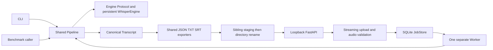

# STT MVP architecture

Current implementation structure, inspected from source and README. This is not an assertion that checks or real-model acceptance passed. The [specification](spec.md) owns behavioral contracts, the [README](../../README.md) owns operator setup, and the parent-owned [tracker](../../docs/agents/issue-tracker.md) records evidence/status. Cold/warm CPU measurements are recorded; human quality review remains open.

## Runtime and process boundaries

Python 3.12 and uv use the repository-root `.venv` and `uv.lock`. faster-whisper/CTranslate2 runs Turbo on CPU INT8 with four threads as the baseline. PyAV validates/decodes media; `av>=18,<19` preserves compatibility with faster-whisper 1.2.1's use of `metadata_errors`, removed in PyAV 19. FastAPI/uvicorn serve localhost HTTP, python-multipart parses streamed uploads, pydantic-settings handles environment configuration, SQLite persists jobs/heartbeat, filelock supplies OS-backed ownership/download locks, and psutil samples RAM. pytest/httpx, Ruff, and mypy are configured development tools. Exact dependency ranges are recorded in the [spec](spec.md#runtime-and-stack) and manifest.



The pipeline does not depend on HTTP or persistence. An injectable engine factory supplies the `Engine` Protocol defined in `pipeline.py`; there is no separate engine-base module. The CLI creates a pipeline for its invocation. The worker loads that pipeline's model once before claiming jobs, then processes serially. The benchmark runs cold/warm calls using one pipeline. HTTP handlers validate/store uploads and serve results without loading the model.

## Current source responsibilities

| Source under `src/stt_services/` | Responsibility |
| --- | --- |
| `cli.py` | `transcribe`, `benchmark`, loopback `serve`, and `worker` subcommands; output ownership checks and exit codes. |
| `config.py` | `Settings`, external storage paths, environment-backed limits/timing, and cache defaults. |
| `audio.py` | Supported suffixes, forced demux/protocol restrictions, full-frame validation, capped source spans and cached decoded-to-source timeline lookup. |
| `schemas.py` | `Segment`, `RunMetrics`, and `Transcript`; JSON full text, one-based segment IDs, model timing provenance. |
| `pipeline.py` | `Engine` Protocol/factory, lazy persistent engine, memory sampler, strict timeline validation, orchestration, staging/final metrics serialization/atomic directory rename. |
| `engines/whisper.py` | HF snapshot resolution/revision, CPU INT8 model construction, VAD transcription and segment-generator consumption. |
| `exporters.py` | Shared JSON/TXT/SRT writers and deterministic SRT rounding. |
| `uploads.py` | Exactly-one-file bounded streaming multipart parser, generated upload staging, upload lease, rejected-input cleanup. |
| `jobs.py` | `JobStore`, SQLite WAL transactions, capacity/FIFO claims, recovery, heartbeat/readiness, result leases, retention/orphan cleanup. |
| `worker.py` | Singleton worker filelock, recovery before model loading, persistent pipeline, independent heartbeat and hourly-cleanup threads, job loop. |
| `api.py` | Host/Origin restrictions, error envelopes, submit/status/result/health routes, expiry checks, leased downloads. |
| `benchmark.py` | Cold/warm runs, full-call wall time, source hash and hardware/config/version report. |

Publication lives in the pipeline; cleanup and durable queue operations live in `jobs.py`. There are no separate `publication.py`, `cleanup.py`, `queue.py`, or exporter package required by the current architecture. `tests/` contains verification code; its existence alone is not a test-pass claim. `benchmarks/reports/` may hold sanitized summaries/methodology; private generated media/transcripts/raw benchmark output belong outside the repository.

## Current storage and ownership

```text
repository/
  .venv/                         primary uv environment
  uv.lock                        dependency lock
  src/stt_services/              implementation
  tests/                         ordinary and opt-in integration checks
  benchmarks/reports/            reviewed/sanitized reporting only

D:\ai-stt\                       configurable STT_DATA_DIR, local disk
  cache/huggingface/             default HF_HOME; sole model cache
  cache/uv/                      default UV_CACHE_DIR
  jobs.sqlite3                   jobs and worker heartbeat, plus SQLite sidecars
  worker.lock                    singleton worker ownership
  locks/bucket-0000..1023.lock   bounded upload/download/cleanup lease markers
  jobs/
    .upload-<job_id>/input.ext    bounded pre-acceptance upload staging
    <job_id>/
      input.ext                  accepted service-owned input
      .stt-*/                    transient result staging
      result/
        transcript.json
        transcript.txt
        transcript.srt
  output/                        recommended CLI/private benchmark destinations
```

Set `HF_HOME` and `UV_CACHE_DIR` before downloads; explicitly supplied values override defaults. `Settings.prepare()` creates jobs storage and defaults cache environment variables. HF weights remain in one cache, not a duplicate models directory. The Whisper adapter calls `faster_whisper.download_model`, records the resolved snapshot directory name as model revision, then loads that path.

CLI destinations are caller-selected and may be elsewhere, provided they are outside managed jobs/cache/locks. They must not already exist. Recommend external storage for privacy and repository hygiene. CLI results and user-owned input, including the supplied MP4, are never subject to service retention. Benchmark output contains cold/warm bundles and `benchmark.json`; keep it external. The non-Windows storage default is `~/.local/share/ai-stt`, without claiming deployment there has been tested.

## Validation and transcript flow

`audio.py` checks suffix, bytes, audio presence, and metadata duration, opens the suffix-specific demuxer with `protocol_whitelist=file,pipe`, and decodes every audio frame. Corrupt frames, invalid rates, missing/invalid duration, excessive duration, and more than 16,384 discontinuous source spans fail before inference. Exact accumulated `frame.samples / frame.sample_rate` fractions establish decoded duration and enforce the two-hour ceiling even when metadata is misleading. Each span also records its source PTS offset; gaps are retained in a decoded-to-source timeline map with cached endpoints for binary search. Recording duration is the later of the last source span end and container duration.

`Pipeline.run()` validates the source, prepares configuration, samples RSS, lazily loads/reuses the engine, and times inference through consumption of all model segments. The adapter requests transcription, automatic language detection, VAD, beam five, and no word timestamps. Since decoding presents continuous samples to the model, the pipeline maps decoded timestamps back through the recorded PTS spans, preserving initial offsets, source gaps, and VAD-skipped silence. It reconciles at most one 16-kHz resampling-tail sample, then enforces finite ordered times within recording duration. Segment starts may not descend.

`Transcript.to_dict()` emits schema version, source basename, original recording duration, engine/model/configuration/versions/metrics, full text under `text`, model timing provenance, and one-based segment IDs. TXT/SRT share this canonical transcript object, so export selection cannot trigger inference. Empty speech is a valid empty transcript. The service's source basename is the managed `input.ext`, not the client's absolute path.

## Atomic publication and timing boundaries

The pipeline creates `.stt-*` beside the final destination so staging and rename share a filesystem. It writes all three artifacts, captures transcript metrics, rewrites final JSON metadata inside staging, and only then renames the directory to the absent target. Cleanup of failed staging happens before returning/raising. There is no post-publication JSON rewrite.

Transcript `metrics.total_seconds` ends before final metadata serialization and rename; its `rtfx_total` uses that interval. The benchmark independently wraps `Pipeline.run()` through publication and return, recording `wall_seconds` and per-run `rtfx_total` as full-call measures. Do not present transcript total as full-publication time. RSS is sampled every 50 ms during processing; it represents sampled whole-process memory and may miss shorter peaks.

Service success is persisted only after pipeline publication. Filesystem rename and SQLite success commit are separate operations. A crash between them leaves a directory with a still-running record; worker recovery marks it failed/interrupted, it is never served as success, and failed retention later removes its artifacts. A benchmark's top-level reporting directory is distinct from each atomically published transcript bundle; no whole-benchmark-directory atomicity is claimed.

## Admission, durable state, and readiness

`uploads.py` streams one multipart `file` into generated `.upload-*` staging under an exclusive per-job lease. It bounds file bytes, body overhead, multipart headers, and field count. `api.py` runs full media inspection in a threadpool before admission. `JobStore.enqueue()` uses `BEGIN IMMEDIATE`, counts queued rows, renames accepted upload staging to the generated job directory, inserts the queued row, and commits before `202` with `job_id/status`. Rejection removes upload staging. Admission failure after a move attempts removal; inactive remnants are later orphan-cleanup candidates.

SQLite WAL supports concurrent API/worker connections. FIFO claims use `BEGIN IMMEDIATE`, select the oldest queued row by creation time/ID, and update it to running. At most ten waiting jobs are permitted, in addition to one running job. Exclusive `worker.lock` ownership prevents a second service worker; transactions protect queue admission and claims rather than relying on process-local counts.

Worker startup acquires ownership, recovers prior running rows to failed/interrupted, preserves queued rows, starts heartbeat updates, loads the model once, marks ready, and performs startup cleanup. Hourly filesystem cleanup runs on its own thread so a slow sweep cannot stall heartbeat freshness. API restart only opens the store and does not recover live work. A failed job is recorded as `processing_failed` and the worker can continue with queued work. No autoretry occurs.

Heartbeat runs independently every five seconds by default; stale means age at least 30 seconds. A loading/stopped/absent/stale worker is unavailable; `/health` reports API readiness, worker/model readiness, and heartbeat age with overall `503`, becoming `200` only when ready. Values are configurable. Worker shutdown records stopped status and releases ownership.

The status route emits `id/status`, lifecycle epoch timestamps, `error`, derived `updated_at`, and safe `error_message`. HTTP error envelopes and exact status mappings are owned by the [specification](spec.md#http-contracts). Result routes check status/expiry and serve immutable JSON/TXT/SRT with an exclusive lease held through response completion. Lease contention returns `409`, and cleanup skips the leased job.

## Retention and recovery from cleanup failures

Worker startup cleanup runs after initialization/model load; a separate maintenance thread runs later sweeps hourly, including while inference runs. Terminal retention uses `finished_at` and elapsed UTC days: successful input one day, successful results/status seven days, failed input/artifacts/status one day. Queued/running rows are excluded. GET rejects expired jobs immediately even while deletion awaits a sweep.

`JobStore.cleanup()` leases each terminal job, removes expired files/directories first, then deletes its row; missing files are tolerated and filesystem/lease failures defer work for a later sweep. Untracked directories older than one day are orphan candidates, protected by the corresponding lease. Cleanup resolves deletion targets within managed jobs storage and unlinks symlinks without following their targets. Leases hash job IDs into 1,024 fixed bucket files, bounding marker storage; simultaneous unrelated IDs may briefly contend and receive `409` on a result request. Marker files contain no media/transcript content. User sources, CLI results, caches, and the environment are outside managed cleanup.

## Verification boundaries and remaining acceptance

Ordinary verification uses fake-engine public CLI/API seams, with targeted transaction/fault tests for admission, interruption, publication, and cleanup. pytest excludes integration by default; real-model tests require explicit opt-in. Ruff and mypy are configured. This documentation update reads implementation and commands but supplies no new execution evidence or pass counts.

The approved six-ticket delivery/acceptance scope remains unchanged. Record actual commands/results in parent-owned tickets/tracker. Complete cold/warm baseline measurement on the supplied MP4, disclose downloads/cache conditions, and manually review Thai/English text and original timing. CER/WER remain conditional on reviewed reference text and documented normalization/tokenization. Overall quality/performance acceptance and home-server results are not established by the current architecture.
