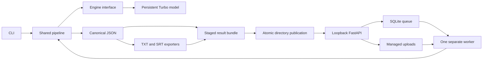

# Planned STT MVP architecture

Status: design only. All modules, commands, storage directories, and checks below are planned unless already identified as documentation. [Specification](spec.md) owns observable contracts; [tracker](../../docs/agents/issue-tracker.md) owns delivery status; [CONTEXT](../../CONTEXT.md) owns terminology.

## Stack and boundaries

Python 3.12 and uv manage one repository-root `.venv` and a future committed `uv.lock`. faster-whisper/CTranslate2 supplies Whisper Turbo inference with `device=cpu`, `compute_type=int8`, and four CPU inference threads. Use its audio-decoding dependencies rather than adding PyTorch. FastAPI handles localhost HTTP, SQLite holds durable job state, and one separately launched worker owns service inference. pytest/httpx, Ruff, and a configured type checker provide future checks.



The pipeline has no HTTP or database dependencies. It accepts a validated source, an engine, and a publication destination, and produces the canonical transcript and completed bundle. The CLI constructs its engine for its process lifetime. The worker constructs its engine once and reuses it for sequential jobs; API request handlers never load a model. Fake engines plug into this same boundary for ordinary tests.

## Planned repository layout

```text
.venv/                         primary environment, untracked
src/stt_services/
  cli.py                       arguments, exit codes, pipeline invocation
  config.py                    storage and fixed inference settings
  schemas.py                   transcript, segment, job and error contracts
  media.py                     byte/container/audio/duration validation
  pipeline.py                  inference orchestration and offset restoration
  publication.py               same-volume staging and atomic publication
  engines/
    base.py                    engine interface
    whisper.py                 faster-whisper adapter and model lifetime
  exporters/
    json.py                    canonical serialization
    txt.py                     text from canonical transcript
    srt.py                     cues from canonical segments
  api.py                       loopback routes and HTTP mapping
  queue.py                     SQLite transactions and job claims
  worker.py                    singleton ownership, recovery, heartbeat, loop
  cleanup.py                   retention and inactive orphan reclamation
tests/                         fake-engine public seam tests
benchmarks/reports/             sanitized methodology/report summaries only
```

Private transcripts, media, raw measurements, and generated report artifacts stay in external storage. The planned repository report location may hold reviewed, sanitized Markdown summaries only. Implementation may refine module names while retaining these responsibilities. Tickets describe behaviors rather than prescribe code or file paths.

## Planned external storage

```text
D:\ai-stt\                     configurable storage root
  cache/
    huggingface/               HF_HOME; sole model cache
    uv/                        UV_CACHE_DIR
  audio/                       user-managed evaluation copies
  uploads/                     API-owned accepted inputs by generated ID
  db/                          SQLite queue and database sidecars
  staging/                     API result staging on result volume
  results/                     published API result bundles by job ID
  cli-results/                 user-managed CLI destinations
  reports/                     private benchmark artifacts
```

Set cache environment variables before dependency/model downloads. Resolve and validate managed paths against the configured root; generate upload IDs and never use a client filename as a filesystem path. CLI staging is a sibling of the requested final directory to preserve same-volume rename semantics. Existing CLI destinations cause a safe failure. Models use the single HF cache rather than being copied into a separate models directory.

## Durable work and process ownership

The API streams an upload into temporary managed storage, enforces size and decoded-media limits, then admits it through a short SQLite transaction that enforces the ten-queued-job cap. Finalize the owned input before committing a queued record. Return `202` only after commit; abandoned pre-commit files are inactive cleanup candidates. The filesystem and SQLite do not share a transaction, so explicit orphan handling is required.

Plan job records with generated ID, state, source metadata, managed input/result references, created/updated/started/finished UTC timestamps, and safe failure details. Persist worker heartbeat/ownership information separately. Claims atomically select the oldest queued job and transition it to running; a single exclusive worker owner prevents concurrent consumers and erroneous recovery of live work. Document the Windows-compatible ownership mechanism during ticket 03.

On worker startup, acquire exclusive ownership, mark prior running jobs failed with `interrupted`, retain queued jobs, load the model, and enter the serial claim loop. Publish heartbeats during model loading and long inference without tying them to job completion. Worker readiness requires successful initialization and a fresh heartbeat; define configurable heartbeat cadence and expiration in implementation. API restart reads this information without mutating live running jobs.

## Transcript and publication flow

1. Validate source byte size, format, decodable audio, and duration before invoking the engine.
2. Transcribe with model segment timing. Restore original offsets after any preprocessing and validate canonical segment invariants.
3. Serialize JSON, then derive enabled TXT/SRT outputs from it. Finish writes and close handles in a private staging directory.
4. Rename the complete directory to an absent final target on the same filesystem. Publish no individual partial result files.
5. For API work, commit succeeded state only after publication. Serve artifacts only for succeeded records.

On inference/export failure, record failed and leave no published success. On crash after rename but before state commit, recovery records interrupted failure and cleanup treats the directory as unpublished orphan data. Downloads read completed artifacts, never staging. Retention must coordinate with claims, publication, and active downloads so it cannot delete in-use data or expose a half-deleted result.

## Cleanup and lifecycle

Run an idempotent sweep on startup and hourly. Apply [spec retention clocks](spec.md#storage-and-retention) using terminal UTC times; exclude queued/running jobs. Reconcile inactive staging, abandoned uploads, and orphan outputs within managed storage. File deletion and metadata expiration require recoverable ordering so partial cleanup can be retried; expired IDs are no longer served. Preserve evidence needed to retry a failed filesystem deletion. Cleanup never touches the model cache, environment, user-managed sources, or CLI results.

## Verification and delivery seams

Ticket 01 establishes CLI JSON through the shared pipeline. Ticket 02 adds exporters and a real baseline. Ticket 03 reuses ticket 01 for API/queue/worker JSON. Ticket 04 connects the exporters to HTTP. Ticket 05 hardens input limits, concurrent admission, and recovery. Ticket 06 adds retention and full acceptance evidence. Ordinary tests invoke the public CLI and HTTP interfaces with fake engines; narrowly targeted queue/publication tests are warranted for race and crash invariants. Real inference remains opt-in.

No implementation, model readiness, test pass, or benchmark outcome is asserted by this architecture.
