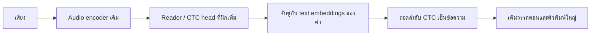
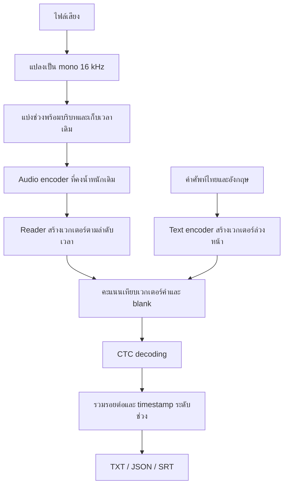
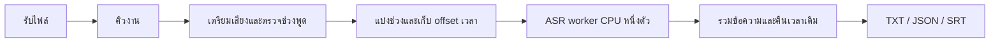

# STT ทดลองบนพีซีและ Home Server

บันทึกการหารือและแนวทางส่งต่องาน วันที่ 14 ตุลาคม 2026

## เป้าหมายและสิ่งที่ผู้ใช้เลือก

- ทดลองใช้ **EmbeddingGemma 2** ทำ speech-to-text ตามแนวทางของ Shahir
- งานหลักคือถอด **ไฟล์เสียงยาว ภาษาไทยปนอังกฤษ**
- ผลลัพธ์ต้องมี **ข้อความพร้อมเวลาเริ่มและจบแต่ละช่วง**
- ปลายทางคือ home server ขนาดเล็ก จึงให้ความสำคัญกับ CPU, RAM และพื้นที่ดิสก์
- โมเดล STT สำเร็จรูปเป็นตัวเทียบเพื่อประเมินความเร็วและความแม่นยำของแนวทาง EmbeddingGemma 2

## เครื่องที่เกี่ยวข้อง

| เครื่อง | CPU | RAM | GPU | พื้นที่เก็บข้อมูล |
|---|---|---|---|---|
| พีซีสำหรับพัฒนา | Intel Core i3-12100F, 4 cores / 8 threads | ประมาณ 16 GB | NVIDIA RTX 3050; Windows รายงาน VRAM 4 GB | C: ว่าง 17.6 GB, D: ว่าง 95.5 GB ณ วันที่บันทึก |
| Home server | Intel Core i7-4770K | DDR3 16 GB | ยังไม่ได้ระบุ; ข้อเสนอใช้สมมติฐาน CPU-only | SSD 1 TB; ยังไม่ทราบพื้นที่ว่าง |

สเปกพีซีอ่านจาก Windows ส่วนสเปก server เป็นข้อมูลที่ผู้ใช้ให้ ยังไม่ทราบระบบปฏิบัติการของ server และยังไม่ได้วัดประสิทธิภาพบน server จริง

## วิธีที่โปรเจกต์ต้นฉบับใช้

EmbeddingGemma Transcribe ใช้ audio encoder ของ EmbeddingGemma 2 โดยคงน้ำหนักเดิม แล้วฝึก reader เพิ่ม ผู้พัฒนาอธิบายว่า reader เป็น CTC head บน audio encoder และใช้ text embeddings ของคำอังกฤษประมาณ 229,000 คำเป็นตัวแทนคำศัพท์ มีโมเดลเล็กอีกตัวเติมวรรคตอนและตัวพิมพ์ใหญ่



- โมเดลอ่านบริบทด้วย ผู้พัฒนาระบุว่ามีบริบทรอบคำประมาณ 20 คำ
- ต้นฉบับรายงานถอดเสียง 1 ชั่วโมงใน **12.6 วินาที** บน M3 MacBook Air 8 GB โดยใช้ **Apple Neural Engine**
- รายงาน WER ประมาณ 5% แต่ยังไม่มีรายละเอียด benchmark เพียงพอให้ใช้เป็นเกณฑ์ความแม่นยำทั่วไป
- ผู้พัฒนาระบุว่าฝึก reader ด้วยเสียงอังกฤษในเวลาต่ำกว่า 2 ชั่วโมงบน 8×H100
- ขณะตรวจสอบ ผู้พัฒนาระบุว่าจะเปิด source code เพิ่ม และยังไม่ได้ทำต้นแบบ multilingual reader

ตัวเลขความเร็วนี้ **ยังใช้คาดการณ์ RTX 3050 หรือ i7-4770K ไม่ได้** และยังไม่มีผลยืนยันภาษาไทยปนอังกฤษ

แหล่งข้อมูล: [หน้าโปรเจกต์](https://eg2.haku.sh/), [คำตอบของผู้พัฒนาใน Hacker News](https://news.ycombinator.com/item?id=50069971), [โพสต์ที่ผู้ใช้อ้างถึง](https://x.com/TslShahir/status/2109660368381395414?s=20)

## Architecture ที่เสนอสำหรับการทดลอง EmbeddingGemma 2

รายละเอียดส่วนนี้เป็นข้อเสนอสำหรับสร้างต้นแบบ ไม่ใช่การยืนยันโค้ดภายในของโปรเจกต์ต้นฉบับ



1. ตรวจสอบก่อนว่าโค้ดและน้ำหนัก reader ของต้นฉบับพร้อมนำมาใช้หรือยัง รวมถึง license และ runtime ที่รองรับ
2. หากต้องพัฒนา reader เอง ให้ดึง representation ของเสียงตามลำดับเวลา **ก่อน pooling**; embedding รวมทั้งคลิปเพียงเวกเตอร์เดียวไม่เพียงพอสำหรับเก็บลำดับคำ
3. เตรียมเสียงคู่กับ transcript ที่ตรวจแล้ว ครอบคลุมไทย อังกฤษ และการสลับภาษา แยกชุดฝึก ชุดปรับโมเดล และชุดทดสอบโดยไม่ให้เสียงซ้ำกัน
4. กำหนดการตัดคำไทยและชุดคำศัพท์ให้สอดคล้องกับ transcript; เปรียบเทียบแนวทางคำเต็มกับหน่วยย่อยหากคำที่ไม่อยู่ในคลังเป็นปัญหา
5. เริ่ม reader ขนาดเล็ก ใช้ CTC loss และคง encoder ไว้ก่อน รายละเอียดชั้นและ hyperparameters ต้องกำหนดหลังทราบ shape ของ encoder และโค้ดต้นฉบับ
6. หากพื้นที่พอ สามารถคำนวณผล encoder ล่วงหน้าเพื่อไม่ต้องรันซ้ำทุก epoch แต่ต้องประเมินขนาดไฟล์ก่อนสร้าง cache ทั้งชุด
7. เริ่ม timestamp ระดับช่วง ส่วน word-level alignment จาก CTC ต้องวัดความคลาดเคลื่อนก่อนใช้จริง
8. ฝึกหรือทดลองบนพีซี RTX 3050 แล้วนำ encoder และ reader ที่ผ่านการประเมินไปทดสอบ inference บน server CPU

Google แนะนำใช้ `bfloat16` บน hardware ที่รองรับ หรือ `float32`; **ไม่ใช้ float16 กับ EmbeddingGemma 2** เพราะ activation อาจเกิด NaN หรือคุณภาพลดลง บน i7-4770K ควรเริ่มจาก float32 ส่วน quantization เป็นงานทดลองเพิ่มเติมที่ต้องตรวจคุณภาพ

การปิด vision encoder ลดหน่วยความจำขณะรัน แต่ไม่ได้รับประกันว่าขนาด checkpoint ที่ดาวน์โหลดจะลดลงด้วย

แหล่งข้อมูล: [EmbeddingGemma 2 model card](https://ai.google.dev/gemma/docs/embeddinggemma/model_card_2), [คู่มือ multimodal](https://ai.google.dev/gemma/docs/embeddinggemma/multimodal-embeddinggemma-with-sentence-transformers)

## ตัวเลือกสำหรับ Server CPU

| ตัวเลือก | เหตุผลที่นำมาเทียบ | ข้อจำกัด |
|---|---|---|
| Typhoon ASR Realtime | ออกแบบสำหรับภาษาไทย มี CPU inference และตัวอย่าง timestamp | ต้องทดสอบคำอังกฤษปนไทย; ไม่ใช้ตัวเลข throughput จากเครื่องอื่นคาดความเร็ว server |
| Qwen3-ASR 0.6B | รองรับไทยและอังกฤษ มี runtime C สำหรับ CPU | ต้องวัดความเร็ว; forced aligner ของโครงการยังไม่ระบุรองรับภาษาไทย |
| Whisper Turbo ผ่าน faster-whisper | รองรับ CPU INT8 และ timestamp เหมาะเป็น baseline | ต้องทดสอบคุณภาพและเวลาบน CPU เก่า |
| Whisper small multilingual INT8 | เป็น baseline เพิ่มเติมที่เบากว่า Turbo และไม่ต้องลง PyTorch สำหรับ faster-whisper | อาจแม่นยำน้อยกว่าโมเดลใหญ่; ต้องใช้รุ่น multilingual ไม่ใช่ `.en` |

runtime C ของ Qwen3-ASR 0.6B รายงาน RAM ประมาณ 2.7–2.8 GiB เมื่อแบ่งเสียงเป็นช่วงบนเครื่องทดสอบของโครงการ เป็นข้อมูลเรื่อง RAM ไม่ใช่ผลความเร็วบน i7-4770K

แหล่งข้อมูล:

- [Typhoon ASR Realtime](https://huggingface.co/typhoon-ai/typhoon-asr-realtime)
- [Qwen3-ASR ทางการ](https://github.com/QwenLM/Qwen3-ASR)
- [Qwen CPU runtime ของ antirez](https://github.com/antirez/qwen-asr)
- [faster-whisper](https://github.com/SYSTRAN/faster-whisper)
- [Whisper Turbo](https://huggingface.co/openai/whisper-large-v3-turbo)

## ซอฟต์แวร์และงบพื้นที่ดิสก์

พีซีมี Python 3.12 และ uv อยู่แล้ว ยังไม่ได้ติดตั้งโมเดลหรือ environment สำหรับงานนี้

| แนวทาง | ส่วนประกอบหลัก | พื้นที่ควรเผื่อ |
|---|---|---:|
| Whisper small INT8 CPU | Python, faster-whisper, โมเดล | 2–3 GB |
| Whisper Turbo INT8 CPU | Python, faster-whisper, โมเดล | 3–5 GB |
| Qwen3-ASR 0.6B runtime C | โปรแกรม, OpenBLAS, โมเดล; compiler เมื่อต้อง build | 3–5 GB |
| Typhoon CPU | Python, PyTorch CPU, typhoon-asr และ dependencies, โมเดล | 5–10 GB |
| EmbeddingGemma 2 CPU | Python, PyTorch CPU, Transformers, Sentence Transformers, ไลบรารีเสียง, โมเดล | 6–10 GB |

ตัวเลขทั้งหมดเป็น **งบพื้นที่ประมาณสำหรับติดตั้งและ cache ช่วงทดลอง** ไม่ใช่ขนาดดาวน์โหลดที่ตรวจวัด และไม่รวมชุดข้อมูลฝึก reader, feature cache และ checkpoints ระหว่างฝึก รุ่น CUDA และ dependencies อาจต้องใช้พื้นที่เพิ่มเติม

สำหรับ EmbeddingGemma 2 ต้องมี reader และคลังเวกเตอร์คำเพิ่มจึงจะเป็น STT การโหลดโมเดลฐานอย่างเดียวให้ความสามารถ embedding

แผนเก็บไฟล์บนพีซีเพื่อไม่ให้กิน C:

```text
D:\ai-stt\
  .venv\       Python environment ของการทดลองที่เลือก
  models\      น้ำหนักโมเดลที่จัดเก็บเอง
  cache\       cache ของ uv และ Hugging Face
  audio\       เสียงทดสอบ
  output\      transcript และรายงานผล
```

- ตั้ง `HF_HOME` และ `UV_CACHE_DIR` ไปใต้ D: ก่อนดาวน์โหลด
- เลือกวิธีเก็บน้ำหนักเพียงที่เดียว ระหว่าง Hugging Face cache กับโฟลเดอร์โมเดลที่กำหนดเอง เพื่อเลี่ยงการคัดลอกซ้ำ
- ทดลองทีละโมเดลและเก็บเฉพาะเวอร์ชันที่ต้องใช้; หาก dependency ขัดกันค่อยแยก environment โดยคิดพื้นที่เพิ่ม
- CPU-only ไม่จำเป็นต้องลง CUDA Toolkit, Ollama, LM Studio, Anaconda หรือ Docker Desktop
- faster-whisper ใช้ CTranslate2 และไม่ต้องมี PyTorch; อ่านเสียงผ่าน PyAV ที่รวม FFmpeg libraries
- home server ใช้โครงสร้างโฟลเดอร์เทียบเท่าตาม OS; ยังไม่กำหนด path จนทราบ OS และพื้นที่ว่าง

## รูปแบบบริการที่เสนอ



- โหลดโมเดลค้างไว้ใน worker เพื่อลดการโหลดซ้ำ
- เริ่ม CPU threads ที่ 4 แล้วเทียบกับ 8 โดยดูผลกระทบต่อบริการอื่น
- ใช้คิวและ worker หนึ่งตัวก่อนเพื่อควบคุม CPU และ RAM
- สำหรับ baseline เริ่มช่วงเสียง 20–30 วินาที แล้วปรับตามข้อกำหนดของโมเดล; reader ของ EmbeddingGemma ต้องมีบริบทตามที่ฝึก
- VAD ต้องทดสอบคำพูดเบาและคำสั้น ไม่ตัดทิ้งเพียงเพื่อเพิ่มตัวเลขความเร็ว
- เก็บเวลาเดิมเมื่อข้ามช่วงเงียบ และตรวจคำซ้ำ/ตกหล่นตรงรอยต่อ

## การวัดผลและงานถัดไป

ใช้เสียงไทยปนอังกฤษชุดเดียวกันทุกโมเดล เริ่มคลิปประมาณ 10 นาที แล้วทดสอบไฟล์ยาวขึ้นเมื่อผลเบื้องต้นผ่าน

| สิ่งที่วัด | วิธีรายงาน |
|---|---|
| เวลารวม | ตั้งแต่รับไฟล์จนเขียนผลเสร็จ |
| เวลาโหลดโมเดล | แยกจาก inference และรายงานทั้ง cold/warm run |
| ความเร็ว | RTFx = ความยาวเสียง / เวลาประมวลผล; ระบุว่าใช้เวลารวมหรือ inference |
| หน่วยความจำ | RAM สูงสุด; VRAM สูงสุดสำหรับพีซี |
| ความถูกต้อง | CER ภาษาไทย, WER เมื่อกำหนด tokenizer แล้ว, คำอังกฤษ ชื่อเฉพาะ และตัวเลข |
| Timestamp | ความคลาดเคลื่อนเทียบช่วงที่ตรวจโดยคน |
| การใช้ server ร่วมกับงานอื่น | CPU และผลกระทบต่อบริการที่ใช้อยู่ |
| พื้นที่ดิสก์ | environment, น้ำหนัก, download cache และข้อมูลฝึกแยกกัน |

งานถัดไปที่ยังต้องทำ:

1. ยืนยัน OS, GPU (ถ้ามี), พื้นที่ว่าง และบริการเดิมบน home server
2. ตรวจสถานะ source code และ reader ของ EmbeddingGemma Transcribe อีกครั้งก่อนติดตั้งหรือทำซ้ำ
3. เตรียมคลิปทดสอบพร้อม transcript ที่ตรวจแล้ว และเลือก baseline เพียงหนึ่งตัวเพื่อประหยัดพื้นที่
4. วัด baseline บน server จริงก่อนกำหนดเป้าหมายความเร็ว
5. เริ่ม EmbeddingGemma encoder experiment แล้วประเมินความเป็นไปได้ของ reader ไทยปนอังกฤษ

**สถานะ ณ วันที่บันทึก:** มีเอกสารและ architecture สำหรับส่งต่องาน ยังไม่ได้ติดตั้ง dependencies, ดาวน์โหลดโมเดล, ฝึก reader หรือรัน benchmark และยังไม่มีผลรับรองว่าถอดเสียงได้ 288× บนเครื่องทั้งสองเครื่อง
