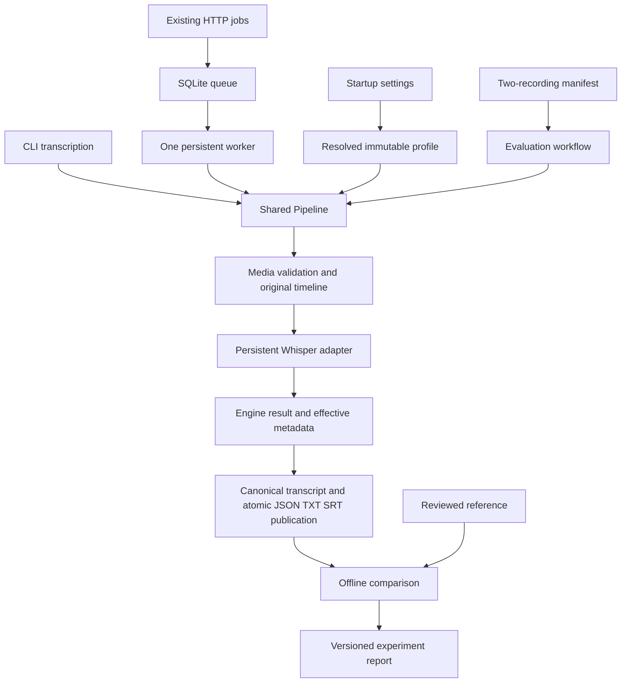

# Proposed structure for measurable STT improvement

Date: 18 October 2026. Research and architecture proposal, not an implementation or acceptance report. This note supplements the [follow-up research](stt-quality-performance-followup-20261018.md) and the [approved optimization specification](../../.scratch/stt-optimization/spec.md). The owner-requested follow-up requirements are incorporated into the same six tickets using the already approved public seams and blocking edges. Additional future optimizations below are identified separately.

## Recommended direction

Keep one transcription pipeline and make its configuration and evidence trustworthy. First establish a reviewed reference and a controlled CPU baseline; then compare a small number of explicit profiles. Investigate the existing RTX 3050 for development-host latency, while keeping a separately measured CPU profile for the home server. Select a profile using reviewed quality and full-call turnaround together.

Three things need different evidence:

| Question | Evidence needed |
| --- | --- |
| Does the transcript match the speech? | A human-reviewed spoken reference, fixed normalization/language rules, coverage, and important-error/timing review. |
| Why does Kob vary or run slowly? | Effective options, stage timing, run-to-run text differences, and observable language/VAD/fallback diagnostics. |
| Which configuration should the worker use? | Same-host baseline versus a frozen candidate, repeated warm runs on both authorized recordings, resource limits, and delivery through the persistent worker. |

The existing exploratory Kob Thai CER median 44.22% is disagreement with an unreviewed publisher-subtitle projection. It cannot be relabeled as a percentage of speech recognized incorrectly. Reference validation may change this score without improving the recognizer; genuine substitutions and omissions still require investigation. Detailed private examples and raw reports stay external to Git.

## Local observations

- Source inspection finds Turbo, CPU INT8, four inference threads, beam five, automatic language, VAD, no word timestamps, and one reused model in the worker. The pipeline currently constructs reported configuration itself while the Whisper adapter discards most returned information. [Engine](../../src/stt_services/engines/whisper.py), [pipeline](../../src/stt_services/pipeline.py).
- Read-only hardware discovery returned an i3-12100F with four physical/eight logical cores, 17006338048 bytes RAM (about 15.84 GiB), and RTX 3050 with 6144 MiB VRAM, NVIDIA driver 610.88. These observations are not GPU model-loading or transcription evidence.
- The lockfile and installed code identify faster-whisper 1.2.1 and CTranslate2 4.8.3. Generic installation documentation disagrees with tagged Windows build settings; verify the actual wheel/runtime before prescribing CUDA libraries. See the [version-specific research](stt-quality-performance-followup-20261018.md#gpu-and-benchmark-caveats).
- The exploratory CPU runs produced Formal Words warm median 178.534 seconds, RTFx 1.578, and Kob warm median 1164.670 seconds, RTFx 0.513. Approximate unrelated CPU activity was recorded, so neither is an accepted isolated-host baseline. [Existing measurement evidence](../optimization-verification-20261018.md#real-measurements-and-pending-acceptance).
- Source inspection finds repeated decoding: media inspection decodes for validation/timeline mapping and faster-whisper decodes the path again. The HTTP submission also validates before queue admission. The size of this overhead has not been measured. [Media module](../../src/stt_services/audio.py), [pipeline](../../src/stt_services/pipeline.py), [submission](../../src/stt_services/api.py), [pinned upstream decoder](https://github.com/SYSTRAN/faster-whisper/blob/v1.2.1/faster_whisper/audio.py).

## One production interface and one evaluation workflow



The **Pipeline module** keeps its existing small interface: a source and a new output destination yield a complete transcript bundle. The **Engine interface** is the existing seam where the real Whisper adapter or fake adapter can vary. Evaluation calls this same interface. A reference is supplied to evaluation only; the production recognizer does not receive answer text.

Do not introduce a second pipeline for GPU, batching, or diagnostics. Sequential and batched behavior belong inside the Whisper adapter, sharing model ownership. A profile is resolved at startup and is fixed for a worker lifetime. Changing the worker's profile requires an explicit restart; HTTP submissions do not carry decoder knobs.

## Responsibilities and proposed interfaces

These are proposed type/responsibility changes, not new implemented options. Keep related types in the existing modules until their size or genuine reuse warrants extraction.

| Module | Interface and responsibility | Complexity it hides |
| --- | --- | --- |
| Configuration | Resolve startup settings into one immutable `ResolvedProfile`, or return an actionable validation error. | Supported combinations, profile identity, private hint identity, baseline defaults, device/precision intent, and version-dependent constraints. |
| Whisper adapter | Load once and transcribe through the existing Engine seam, returning an internal `EngineResult`. | CTranslate2 construction, sequential/batched arguments, generator consumption, resolved runtime metadata, and diagnostic collection. |
| Shared pipeline | Run validation, inference, source-time restoration, and complete bundle publication. | Output ownership, memory sampling, finite timestamp checks, staging, and canonical export consistency. |
| Reference module | Prepare review drafts and compare a result with a matching reviewed reference under a fixed scoring policy. | Publisher-line provenance, language/orthography decisions, review gates, coverage, normalization, and error counts. |
| Benchmark/evaluation modules | Execute an explicit allowed run plan and compare saved bundles. | Source guards, cold/warm definitions, host observations, repetitions, profile/ref identities, and aggregation. Reuse timing/reporting helpers where the two callers already duplicate behavior. |
| Worker and HTTP modules | Submit, execute, and serve existing jobs using the chosen startup profile. | Queue durability, model reuse, readiness, recovery, result leasing, and retention. |

An `EngineResult` should carry recognized segments, an effective configuration snapshot, model/runtime identity, and optional diagnostic evidence. Canonical segments keep their existing text/time contract. This avoids every caller knowing faster-whisper's segment implementation. The real and fake adapters should both satisfy the changed interface in one narrow delivery slice.

The adapter should report actual device/compute type after loading. Record requested and effective precision separately when the runtime resolves `int8` into a more specific representation. Unsupported requests must be explicit failures; a CPU result must not be described as GPU success. [CTranslate2 compute-type behavior](https://opennmt.net/CTranslate2/quantization.html).

### Immutable profiles prevent cross-job state drift

A profile snapshot should identify the model snapshot, backend versions, device, effective precision, CPU threads, beam, sequential/batched mode, batch size, language policy, context policy, temperature/fallback policy, explicit VAD options, timestamp options, and private hint revision. Keep model-window length fixed at 30 seconds in this phase. Profile names and hashes describe configuration; they do not imply acceptance.

Build fresh upstream argument dictionaries for every call. In the pinned source, batching can mutate supplied VAD dictionaries, while a changed window length can mutate a shared feature extractor. Changing profile fields during reuse can therefore affect later jobs. Immutability plus fresh arguments is useful protection even with a single worker. [Pinned transcription code](https://github.com/SYSTRAN/faster-whisper/blob/v1.2.1/faster_whisper/transcribe.py), [feature extractor](https://github.com/SYSTRAN/faster-whisper/blob/v1.2.1/faster_whisper/feature_extractor.py).

Initially expose only the small controls required by the approved experiments. Avoid a generic registry, unrestricted option dictionaries, new per-request HTTP configuration, or a profile for every Cartesian-product combination.

### Evidence must say what was actually observed

| Evidence | Recording rule |
| --- | --- |
| Language | Record forced/detected/per-window policy. A forced language's returned probability of 1 is not measured confidence; use a distinct source and no invented detected probability. |
| Segment diagnostics | Retain engine-reported average log probability, no-speech probability, compression ratio, and temperature externally where useful. They are not calibrated transcript-correctness probabilities. |
| Fallback | Count attempts/time only when actually observed. A final returned temperature cannot recover retry count; label unavailable information explicitly. Avoid modifying upstream private methods just to fabricate a count. |
| VAD | Record effective options and duration retained. Sequential/batched defaults differ, so defaults must not be hidden behind the same profile label. |
| Repeatability | Compare canonical text hashes/diffs, error categories, and per-run scores across repetitions. A binary JSON hash also includes timing/metadata and is insufficient to establish text differences by itself. |
| Timing | Keep authorization/reference preflight and offline scoring separate from pipeline full-call time. Add validation, engine processing, and publication stage observations; use public upstream timing hooks or leave finer model-stage times unavailable. |
| GPU memory | Distinguish process RAM from device memory. Device-wide readings may include desktop/other-process use and must disclose attribution limits. |

Keep existing transcript fields compatible and add stable effective metadata only. Put detailed private diagnostics in an externally stored, versioned evaluation report/sidecar. If a diagnostic sidecar becomes part of an inference bundle, write it in staging before atomic publication. Never append to a published immutable result directory. Optional raw debugging can contain speech, so retain it only with private experiment evidence.

## Experiment order and budget

The current tracker still gates experiments on OPT-01 completion. The following narrows candidate selection without changing its dependencies.

| Stage | Action | Decision it resolves |
| --- | --- | --- |
| A: reference and baseline | Human-check publisher-derived speech, preserve English, freeze scoring and coverage. Obtain an idle-host baseline with one cold and at least three reused-model warm calls per recording. | Whether reported errors correspond to actual speech, and whether timing is reproducible. |
| B: diagnostics | Observe initial language, VAD removal, text variability, fallback evidence, and broad stage times at the baseline. | Which mechanism justifies a controlled change. Sampling fallback is a plausible cause of variability, not a proven diagnosis of Kob. |
| C: CPU screening | On Formal Words, compare beam 5/3/1, then threads 4/2, changing one factor per case. Keep remaining options and model revision fixed. | A candidate CPU profile with measured quality/time trade-offs. |
| D: language/context screening | Independently compare auto versus Thai hint and supported per-window mode, context on/off, and short permitted vocabulary hints. An evidence-justified fallback/VAD case is separately labeled. | Whether language selection, context propagation, or quiet-speech handling explains reviewed errors. |
| E: GPU and batching | With exact-runtime compatibility established, start sequential GPU with supported `float16` or `int8_float16`. Separately compare sequential to batched path at batch 1, then batch 2/4. | Whether existing hardware or batching improves latency within RAM/VRAM and reviewed quality constraints. |
| F: frozen evaluation and worker | Freeze chosen settings, then evaluate Kob and both-recording finalists with at least three warm calls and service delivery checks. | Whether to adopt a host-specific profile, retain baseline, or report unmet/pending outcomes. |

One exploratory screening measurement per candidate is a way to eliminate bad cases, not acceptance evidence. Repeat only plausible finalists and the baseline. CPU/GPU comparisons use the same host and model snapshot; they still compare different precision paths if the effective compute types differ. Report that fact.

Start GPU work conservatively on the observed 6 GiB card. Do not copy batch 16 from an example or claim a particular speedup/VRAM fit from another model/card's benchmark. GPU availability does not itself improve recognition accuracy. The official README supports GPU and batching investigation, but its published benchmark uses different models and hardware. [Versioned faster-whisper README](https://github.com/SYSTRAN/faster-whisper/blob/v1.2.1/README.md#benchmark).

Formal Words is the tuning recording. Kob's current scores and examples have already been inspected; disclose this prior exposure, freeze settings before the next final comparison, and avoid claiming a statistically independent untouched holdout. Never build a glossary or select parameters from Kob's answer text.

## Reference and scoring design

Preserve publisher originals and every cue's provenance. A reviewer selects actual speech, keeps English-only speech, excludes unspoken translations/romanization, and marks uncertainty and timing-review state. A review flag must reflect listening to the recording. Scores should include the reference/policy revision and reference-unit counts, so a small English denominator cannot look like broad English validation.

Freeze handling of Thai tone/vowel marks, punctuation, fillers, repetitions, numbers, and English words rendered in Thai script before comparing candidates. Report raw and normalized full-text error alongside Thai CER and English WER. Script projections alone can miss ordering or penalize a change of writing convention; use a separate reviewed category for transliteration/language-switch errors rather than retrospectively changing normalization to improve a score.

The current scorer correctly returns pending review when any cue lacks review/provenance; keep that gate. Cue-level diagnostic displays may help localize errors but require caution: a model segment can overlap several subtitle cues, and unreviewed publisher timestamps do not establish exact phrase alignment. Do not create partial-reference scores by comparing a short reviewed reference against the entire hypothesis. Any future partial scoring needs explicit matching scopes and reported unscored intervals.

Offline rescoring of preserved canonical bundles should not rerun inference. This makes reference corrections cheap and keeps changes in scoring distinct from improvements in transcription. New CLI syntax for that workflow should be introduced only in its approved implementation slice.

Bind a saved bundle to its evaluation run record and source identity with content hashes; a basename alone is insufficient. Legacy bundles without a reliable binding need an explicit provenance record or an unavailable-identity outcome before they can support acceptance. Rescoring must not silently assume that an arbitrary JSON file came from an authorized source.

## Data layout and everyday management

Use the existing external storage model; names below describe a proposal rather than new commands or created directories:

```text
external storage/
  datasets/<approved-recording-id>/  original media and publisher references
  references/<review-revision>/     reviewed text, provenance, coverage, scoring policy
  experiments/<experiment-id>/
    plan.json                      approved sources, roles, profiles, model/review revisions
    <profile-id>/<recording-id>/
      00-cold/                     complete canonical result bundle
      01-warm/ ...                 complete reused-model bundles
      diagnostics/                 private versioned observations and logs
    comparison.json                per-run values and baseline/candidate comparison
    review.md                      reviewed important errors, timing, and disposition
```

Reference review state and profile disposition are separate: `draft/reviewed` describes speech evidence; candidate selection describes a measured configuration. Reports can state accepted, target unmet, quality pending, unsupported, or inconclusive under the existing specification. Only sanitize summaries into versioned project reports. Avoid a new database/UI while a manifest plus per-run bundles serves these two recordings.

## Optimize media preprocessing only after measuring it

If decoding/validation becomes material after inference is accelerated, consider preparing validated 16-kHz mono samples and timeline metadata once inside a pipeline run, then passing the samples to the Whisper adapter. Pinned faster-whisper accepts NumPy audio and otherwise decodes a path. [Pinned transcribe implementation](https://github.com/SYSTRAN/faster-whisper/blob/v1.2.1/faster_whisper/transcribe.py).

This would be a new, bounded optimization proposal: retain the existing demux restrictions, full corrupt-frame and duration validation, channel/resampling semantics, source identity checks, and decoded-to-original timeline mapping. Keep HTTP pre-admission validation. Avoid a persistent PCM/feature cache initially; it adds invalidation, ownership, retention, and memory complexity. A two-hour mono float32 16-kHz buffer alone is about 439 MiB, excluding temporary copies/model memory. Streaming or bounded external storage needs explicit design if memory requires it.

No preprocessing speedup or recognition improvement is established. Retain the current path unless measured stage cost warrants the change. Denoising, aggressive normalization, and splitting the source into additional test recordings are not part of this proposal.

## Implementation slices

Follow-up requirements added to the existing approved ticket structure:

1. **OPT-01, no blocker:** explicitly resolve the exploratory score's meaning using reviewed speech and documented coverage; keep acceptance pending until reference and controlled baseline evidence exist.
2. **OPT-02, blocked by OPT-01:** include the narrow `EngineResult`/resolved-profile prefactoring as part of a complete CLI/worker configuration-and-reporting slice. Add truthful language/temperature/VAD observations and run-to-run text comparison. No standalone framework-refactor ticket is needed.
3. **OPT-05, blocked by OPT-02:** add specific reviewed code-switch/transliteration/error-propagation checks. Test language/context/hints independently and justify any fallback/VAD change.
4. **OPT-03/04 and OPT-06:** consume those same profile/result contracts for GPU, batching, and final worker adoption. They retain their existing blockers and acceptance requirements.

The preprocessing proposal and selective second-pass/stronger-model/backend experiments are future work requiring separate scope. The present review does not create OPT-07, promote a profile, close a ticket, or change the worker configuration.

## Validation plan

Prefer the existing public CLI/evaluation seam with injected fake adapters, real filesystem publication, and hand-authored reference fixtures. Cover effective profile propagation, unsupported combinations, Unicode/scoring gates, stable exported text, original-time restoration, and source/output preservation. Verify cross-job isolation with two sequential calls, including a failed first call; observable profiles and output behavior must not drift.

Final service checks use the existing HTTP job/result workflow and persistent worker. Runtime/GPU compatibility and reviewed quality require separate real evidence. All real-recording runs remain restricted to the full original Formal Words and Conversation with Kob inputs through the existing guard. No inference or test execution was performed while preparing this proposal.
